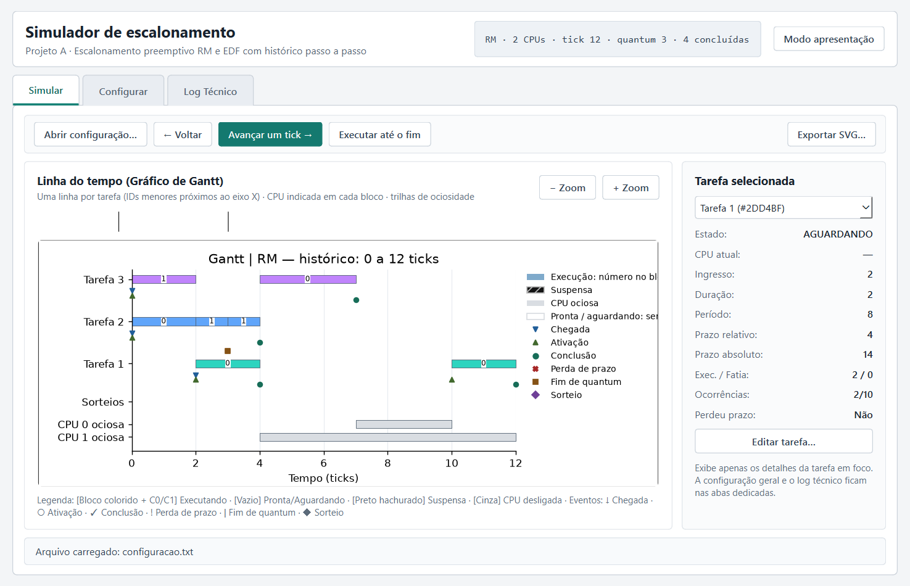

# Formulário Qt Designer — Redesenho da Interface (`ui/janela_principal.ui`)

Este diretório contém a proposta visual em formato `.ui` (Qt Widgets Designer) baseada em [`prototipos/interface.html`](../prototipos/interface.html) e nas diretrizes de [`docs.md`](../docs.md).

> **Estado atual:** o formulário está integrado a [`gui.py`](../gui.py), que o carrega diretamente por `QUiLoader` e conecta os controles. A etapa 1 da revisão foi implementada: barra temporal, Ajustar tudo, rolagem vertical, enquadramento persistente e recorte/legenda do Matplotlib. Os novos controles de navegação são acrescentados em Python a `graficoContainer`. Configuração global validada no motor, sorteio na trilha das selecionadas e exportação final automática foram concluídos; a validação atual está em [`REVISAO_INTERFACE.md`](../REVISAO_INTERFACE.md).

---

## 1. Organização Visual

O formulário (`JanelaPrincipal` — `QMainWindow`) adota uma composição clara, redimensionável e centrada no gráfico de Gantt:

1. **Cabeçalho (`cabecalhoFrame`):**
   - Exibe o título da aplicação (`tituloJanelaLabel`), subtítulo contextual (`subtituloJanelaLabel`), o resumo compacto do estado da simulação (`resumoMetaLabel`).
2. **Navegação em Abas (`abasPrincipais` — `QTabWidget`):**
   - **Aba 1 — `abaSimular` ("Simular"):**
     - **Barra de controles (`barraControlesFrame`):** botões claros para abrir configuração (`abrirArquivoButton`), retroceder (`retrocederButton`), avançar um tick (`avancarButton` com destaque visual primário), executar até o fim (`executarCompletaButton`) e exportar SVG (`exportarSvgButton`).
     - **Área central (`areaCentralSimulacaoLayout` com `stretch="1,0"`):**
       - **Painel do Gráfico (`painelGraficoFrame`, expansível):** cabeçalho, controles de zoom e **`graficoContainer`**, que recebe canvas, Ajustar tudo e a barra temporal horizontal. A legenda estática `legendaGanttLabel` é ocultada em execução; a única legenda é gerada por `gantt.py`, dentro da Figure, ao final da área rolável.
       - **Inspeção da Tarefa Selecionada (`inspecaoTarefaFrame`, largura controlada 265–310 px):** seletor da tarefa em foco (`tarefaSelecionadaCombo`), `QFormLayout` (`detalhesTarefaFormLayout`) apenas com os dados da tarefa selecionada e botão de edição (`editarTarefaButton`), eliminando a tabela permanente de 13 colunas da tela principal.
     - **Rodapé de status (`rodapeStatusFrame`):** mensagem de status e ociosidade das CPUs (`mensagemStatusLabel`).
   - **Aba 2 — `abaConfigurar` ("Configurar"):**
     - Separa a parametrização do acompanhamento da execução.
     - Controles de parâmetros globais (`algoritmoCombo`, `quantumEntrada`, `quantidadeCpusEntrada`), botões de carga/aplicação (`carregarArquivoConfigButton`, `aplicarConfiguracaoButton`) e tabela das características de entrada das tarefas (`tabelaConfiguracaoTarefas`).
   - **Aba 3 — `abaLogTecnico` ("Log Técnico"):**
     - Área secundária dedicada ao histórico textual de eventos e avisos (`logEventosPlainTextEdit`), evitando que o log técnico dispute espaço visual com o gráfico de Gantt.

O modo apresentação e o acompanhamento automático foram retirados para simplificar a interface. As abas e os controles essenciais permanecem visíveis.

---

## 2. Principais `objectName`s dos Componentes

| Componente (`objectName`) | Classe Qt | Papel na integração atual |
| --- | --- | --- |
| `JanelaPrincipal` | `QMainWindow` | Janela principal redimensionável |
| `cabecalhoFrame` | `QFrame` | Topo com título e resumo |
| `resumoMetaLabel` | `QLabel` | Exibição de `<algoritmo> · <N> CPUs · tick <t> · quantum <q>` |
| `abasPrincipais` | `QTabWidget` | Separação entre `abaSimular`, `abaConfigurar` e `abaLogTecnico` |
| `barraControlesFrame` | `QFrame` | Barra de operação da simulação |
| `abrirArquivoButton` | `QPushButton` | Abertura de arquivo de configuração (`.txt`) |
| `retrocederButton` | `QPushButton` | Retrocesso de 1 tick no histórico (`simulacao.retroceder()`) |
| `avancarButton` | `QPushButton` | Avanço de 1 tick no histórico (`simulacao.avancar()`) |
| `executarCompletaButton` | `QPushButton` | Execução até concluir as 10 ocorrências de cada tarefa periódica |
| `exportarSvgButton` | `QPushButton` | Exportação do gráfico vetorial via `exporter.exportar_svg()` |
| `painelGraficoFrame` | `QFrame` | Quadro principal que envolve cabeçalho do gráfico, canvas e legenda |
| **`graficoContainer`** | **`QWidget`** | **Contêiner no qual `gui.py` insere o canvas e a barra Matplotlib** |
| `zoomMenosButton` / `zoomMaisButton` | `QPushButton` | Controles de escala horizontal da linha do tempo |
| `legendaGanttLabel` | `QLabel` | Legenda de estados (executando, pronta, suspensa, CPU desligada) e marcadores |
| `inspecaoTarefaFrame` | `QFrame` | Painel lateral com dados exclusivos da tarefa selecionada |
| `tarefaSelecionadaCombo` | `QComboBox` | Seleção da tarefa inspecionada |
| `valorEstadoLabel` | `QLabel` | Estado atual (`AGUARDANDO`, `PRONTA`, `EXECUTANDO`, `SUSPENSA`, `FINALIZADA`) |
| `valorCpuLabel` | `QLabel` | CPU alocada no tick atual (`0`, `1`, … ou `—`) |
| `valorIngressoLabel` | `QLabel` | Instante de ingresso da tarefa |
| `valorDuracaoLabel` | `QLabel` | Duração por instância |
| `valorPeriodoLabel` | `QLabel` | Período da tarefa |
| `valorPrazoLabel` | `QLabel` | Prazo relativo (deadline) |
| `valorPrazoAbsolutoLabel` | `QLabel` | Prazo absoluto da ocorrência atual |
| `valorExecucaoLabel` | `QLabel` | Progresso na instância atual e na fatia de quantum |
| `valorOcorrenciasLabel` | `QLabel` | Instâncias concluídas (`k/10`) |
| `valorPerdeuPrazoLabel` | `QLabel` | Indicador de perda de prazo (`SIM` / `Não`) |
| `editarTarefaButton` | `QPushButton` | Abertura do diálogo de edição para `modificar_tarefa_em_execucao()` |
| `mensagemStatusLabel` | `QLabel` | Feedback de operações, erros e contadores de CPUs desligadas |
| `algoritmoCombo` | `QComboBox` | Escolha do algoritmo (`RM` ou `EDF`) na aba Configurar |
| `quantumEntrada` | `QLineEdit` | Ajuste de quantum na aba Configurar |
| `quantidadeCpusEntrada` | `QLineEdit` | Ajuste da quantidade de CPUs na aba Configurar |
| `tabelaConfiguracaoTarefas` | `QTableWidget` | Tabela de parâmetros de entrada das tarefas na aba Configurar |
| `logEventosPlainTextEdit` | `QPlainTextEdit` | Log técnico detalhado na aba secundária `abaLogTecnico` |

---

## 3. Como Abrir, Pré-visualizar e Ajustar no Qt Designer

### Abrir no Qt Widgets Designer
Com o ambiente `.venv-windows` configurado na raiz do projeto, execute:

```powershell
.\.venv-windows\Scripts\pyside6-designer.exe ui\janela_principal.ui
```

### Executar a aplicação integrada

Na raiz do repositório:

```powershell
.\.venv-windows\Scripts\python.exe gui.py exemplos/configuracao.txt
```

O arquivo `.ui` é localizado em relação a `gui.py`, não ao diretório corrente. Ele precisa acompanhar o código e ser incluído como recurso no futuro executável. Não é necessário executar `pyside6-uic` para abrir a aplicação.

### Dicas de Edição no Designer
- **Pré-visualização rápida:** no Qt Designer, pressione `Ctrl + R` (*Form → Preview*) para examinar os layouts e as abas. A lógica Python do gráfico e da simulação não é executada nessa prévia; teste esses comportamentos rodando `gui.py`.
- **Inspeção de hierarquia e layouts:** utilize o painel *Object Inspector* (canto superior direito do Designer) para navegar pelos layouts (`QVBoxLayout`, `QHBoxLayout`, `QFormLayout`). Nenhum componente usa geometria fixa absoluta; o espaço principal é atribuído ao `painelGraficoFrame` via `stretch="1,0"` em `areaCentralSimulacaoLayout` e `sizePolicy` `Expanding`.
- **Integração existente do Matplotlib:** `_configurar_grafico_matplotlib()` em `gui.py` oculta o placeholder e a legenda estática, libera o tamanho mínimo do contêiner e adiciona a navegação/canvas. A altura do canvas acompanha as trilhas para permitir rolagem real; o deslocamento temporal controla os limites X, sem criar uma imagem de largura ilimitada. Alterações no `.ui` devem preservar os `objectName`s usados por `_obter_widget()`.
- **Compilação opcional para Python (se desejado futuramente):**
  ```powershell
  .\.venv-windows\Scripts\pyside6-uic.exe ui\janela_principal.ui -o ui\ui_janela_principal.py
  ```

---

## 4. Pré-visualização Real Renderizada

A captura abaixo registra uma versão anterior do formulário, ainda com modo apresentação; não representa exatamente os controles atuais. Não comprova a navegação do gráfico integrado nem sua legibilidade em simulações extensas.


